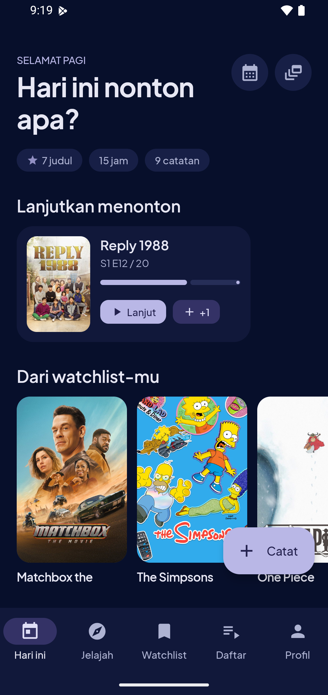
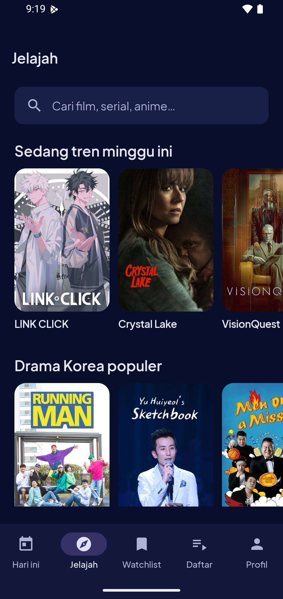
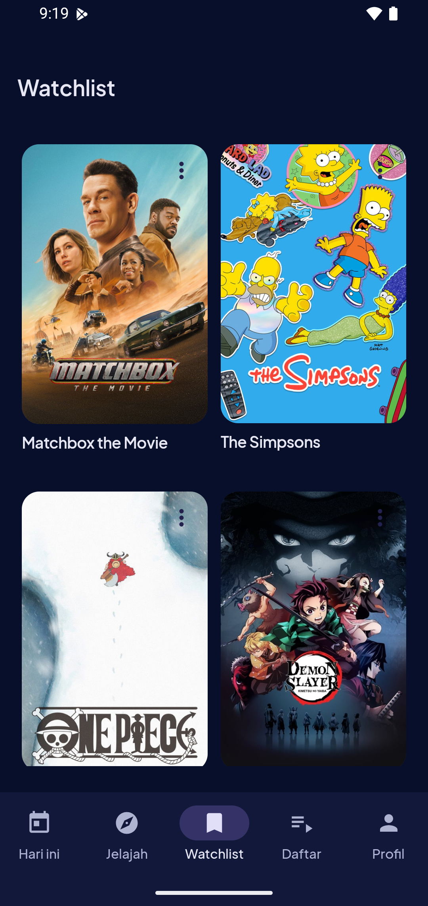
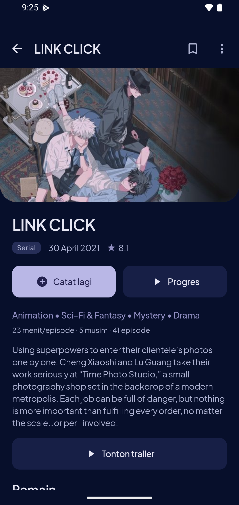
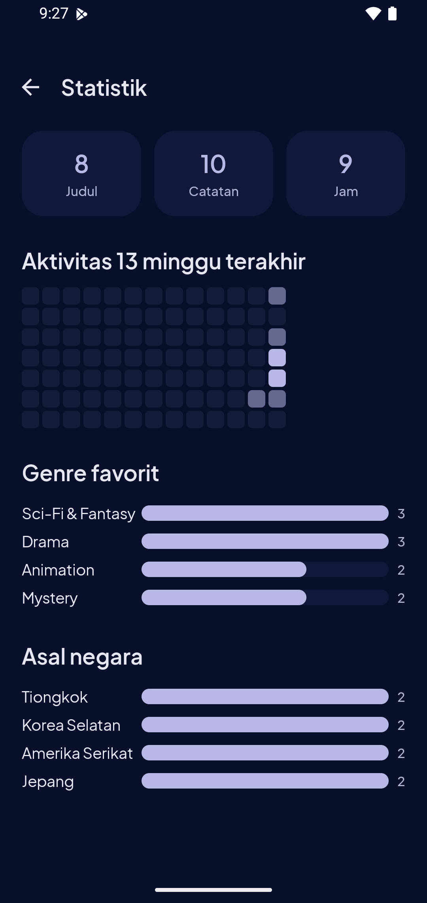
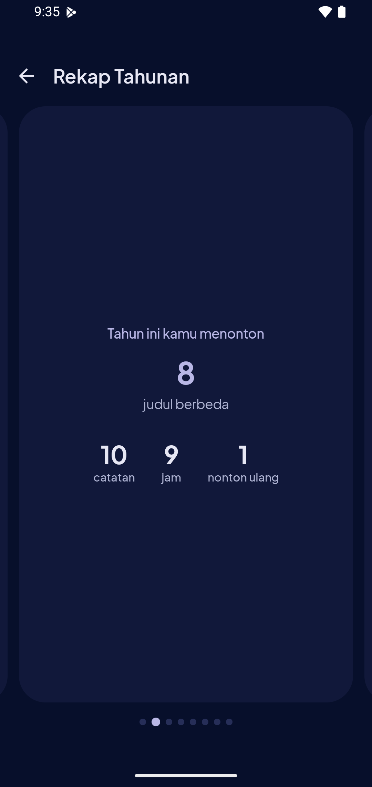
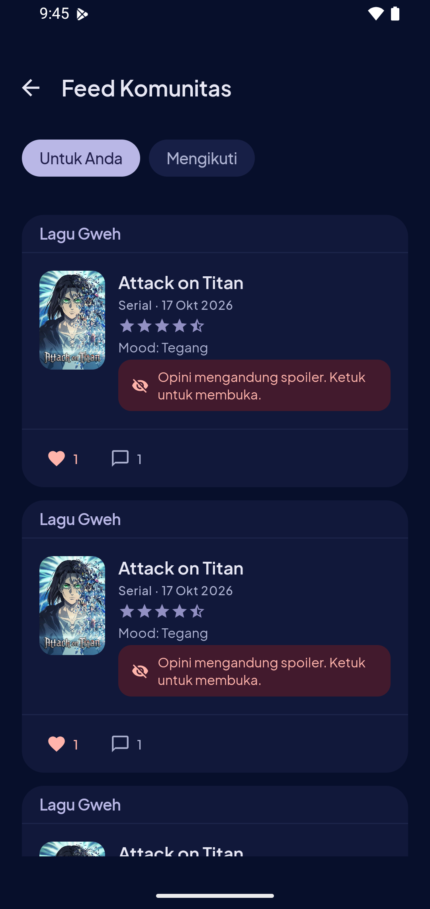
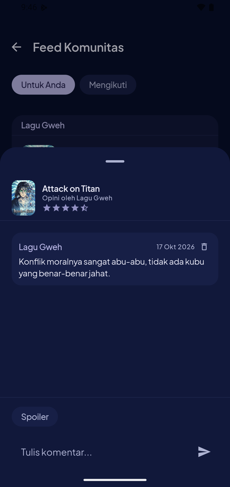
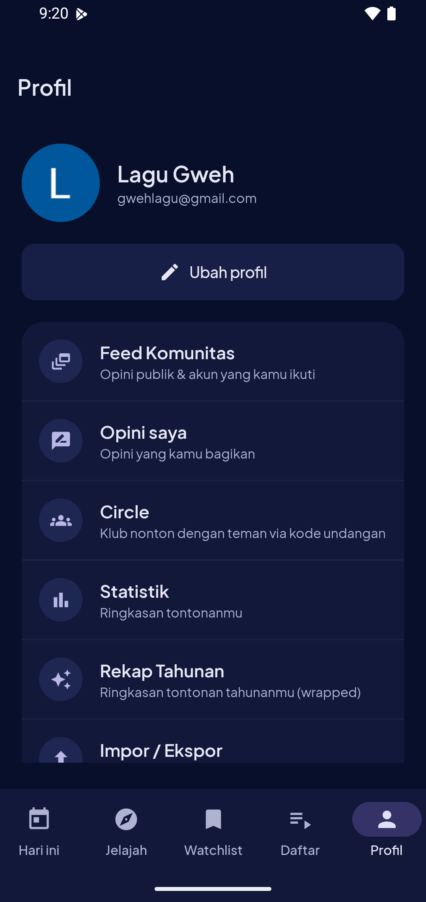
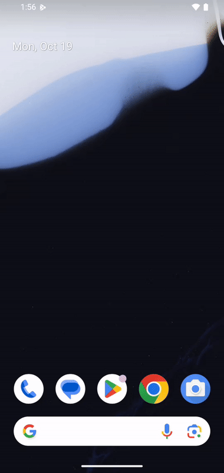

# Today

[](https://github.com/aab-dii/Today/actions/workflows/ci.yml)


**Today** adalah aplikasi Android untuk penonton Indonesia: catat apa yang kamu tonton hari ini — film, serial, maupun anime — sebagai **diary nonton yang personal**. Rating, mood, catatan, dan siapa yang nonton bareng; lalu lihat bagaimana penilaianmu berubah saat menonton ulang.

Pendekatannya **log-first**: aplikasi membuka dengan pertanyaan *"hari ini nonton apa?"*, bukan dengan feed orang lain.

> **Coba langsung:** unduh APK dari [Releases](https://github.com/aab-dii/Today/releases) — tanpa perlu menyiapkan API key.

## Screenshot

| | | |
|---|---|---|
|  |  |  |
| **Beranda** | **Jelajah** | **Watchlist** |
|  |  |  |
| **Detail judul** | **Statistik** | **Rekap Tahunan** |
|  |  |  |
| **Feed Komunitas** | **Komentar (spoiler)** | **Profil** |

**Demo menit pertama** — dari beranda ke simpan tontonan:



## Fitur

**Diary nonton**
- Catat tontonan dengan rating ½ bintang, mood (7 preset), catatan pribadi, dan teman nonton.
- **Rewatch** dengan linimasa penilaian — lihat evolusi selera dan rating dari waktu ke waktu.
- **Tracking episode** serial dengan total musim/episode dari TMDB.
- Diary baru menimpa entri lama otomatis, plus *quick log* dari beranda.

**Katalog & penemuan**
- Katalog film + serial dari TMDB, lengkap dengan detail, pemain, dan rekomendasi **"Mirip dengan ini"**.
- Pencarian dan filter jelajah.
- **Watchlist** dan **daftar kustom** (koleksi bertema buatan sendiri).
- **Jadwal rilis**: episode TV mendatang dan film belum rilis dari watchlistmu, dikelompokkan per hari.

**Statistik & rekap**
- Stats dasar: jumlah tontonan, jam menonton, distribusi rating, genre, dan mood.
- **Rekap Tahunan** bergaya cerita: total judul, genre & negara favorit, mood dominan, bulan tersibuk, streak hari beruntun, dan bagikan hasilnya sebagai teks.

**Komunitas**
- **Auth** (email/sandi + Google) dengan profil pengguna.
- **Bagikan opini** per-entri diary, dengan takar **spoiler**.
- **Feed** "Untuk Anda" dan "Mengikuti", aksi **follow/unfollow**, **like**, dan **komentar** real-time dengan mask spoiler *tap-to-reveal*.
- **Profil publik** pengguna lain beserta opini publiknya.
- **Circle**: klub menonton via kode undangan 6 karakter, dengan feed opini anggota.

**Lain-lain**
- **Impor / ekspor CSV** — format Today maupun diary **Letterboxd**.
- **Notifikasi jadwal rilis** harian (WorkManager, lokal tanpa server).
- Mode gelap sebagai tampilan default.

Diary, watchlist, daftar, dan statistik bekerja **offline** (Room). Katalog butuh internet saat pertama kali memuat.

## Tech stack

| Area | Teknologi |
|---|---|
| Bahasa | Kotlin |
| UI | Jetpack Compose + Material 3 |
| Arsitektur | Multi-module, Clean Architecture (domain/data/UI) |
| DI | Koin |
| Network | Retrofit + OkHttp + Gson |
| Database | Room + Paging |
| Gambar | Coil |
| Backend | Firebase (Auth + Firestore) |
| Background | WorkManager |
| Async | Coroutines + Flow |
| Sumber data | [TMDB API](https://developer.themoviedb.org/docs) |

## Struktur modul

```
Today/
├── app/       # shell + seluruh UI Compose (beranda, jelajah, detail, diary, watchlist, daftar, stats, rekap, sosial)
├── core/      # domain + data: katalog TMDB, Room, diary/watchlist/daftar/stats/rekap/CSV/jadwal
└── social/    # domain + data sosial (Firebase Auth + Firestore: profil/opini/like/komentar/follow/circle) — tanpa UI
```

## Prasyarat

- Android Studio dengan JDK 17+ (AGP 8.6, Gradle 8.7)
- Akun [TMDB](https://www.themoviedb.org/signup) + API key
- Perangkat atau emulator Android 7.0+ (minSdk 24)

## Menjalankan

1. **Clone** repo dan buka di Android Studio; biarkan Gradle sync.

2. **Siapkan API key TMDB** di `local.properties` (root project):
   ```properties
   TMDB_API_KEY=isi_api_key_mu_di_sini
   BEARER_TOKEN=isi_bearer_token_mu_di_sini
   BASE_URL=https://api.themoviedb.org/3/
   ```
   File ini dibaca `core/build.gradle.kts` dan **gitignored** — jangan di-commit. Tanpa file ini aplikasi tetap berjalan, hanya katalog yang kosong.

3. *(Opsional — fitur komunitas)* Taruh `google-services.json` dari project Firebase-mu di folder `app/`. **Wajib gitignored.** Tanpa file ini build tetap hijau dan fitur offline tetap jalan; plugin google-services diterapkan secara kondisional.

4. **Run** konfigurasi `app` ke emulator/perangkat.

## Build & test

```bash
./gradlew :app:assembleDebug   # build debug APK
./gradlew test                 # 142 unit test (core, social, app)
./gradlew lint                 # Android lint
```

| Modul | Test |
|---|---|
| `:core` | 85 |
| `:social` | 22 |
| `:app` | 35 |
| **Total** | **142** |

CI ([`.github/workflows/ci.yml`](.github/workflows/ci.yml)) menjalankan unit test,
Android lint, dan `assembleDebug` di setiap push ke `main`.

## Arsitektur

Tiga modul, batas yang jelas: `:app` memegang seluruh UI Compose, `:core` memegang
domain + data katalog dan diary, `:social` memegang domain + data Firebase tanpa UI.

```
app ──▶ core (domain/data: TMDB, Room, diary) ──▶ Room / TMDB API
 └───▶ social (domain/data: Firebase)         ──▶ Firestore / Firebase Auth
```

Prinsipnya offline-first: katalog diambil lewat `RemoteMediator` ke Room sehingga
tetap terbaca tanpa jaringan, sementara diary, watchlist, dan daftar memang tidak
pernah menyentuh server. Fitur komunitas jadi lapisan di atasnya dan tidak pernah
menjadi syarat untuk mencatat tontonan.

Rincian lengkap ada di [ARCHITECTURE.md](ARCHITECTURE.md).

## Atribusi

Metadata film, serial, dan anime berasal dari [TMDB](https://www.themoviedb.org/).

> This product uses the TMDB API but is not endorsed or certified by TMDB.

## Lisensi

[MIT](LICENSE) © 2026 Muhammad Abdillah Abdi.
