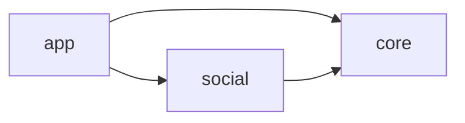
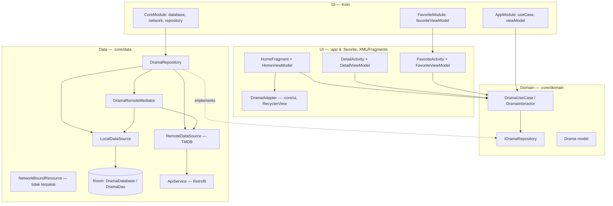

# Arsitektur — Today

> **Status dokumen**: Draft v0.1 (15 Okt 2026), diperbarui 16 Okt 2026.
> Terkait: [PRD](PRD.md) · [Roadmap](ROADMAP.md)

> ⚠️ **Pembaruan 17 Okt 2026 — P0, P1, P2, P3 SELESAI; P4.1 (fondasi sosial) + P4.2 (auth gate & profil) + P4.3 (bagikan opini) + P4.4 (feed & follow) + P4.5 (like & komentar) + P4.5.1 (profil publik pengguna lain) SELESAI.** Ringkasnya:
> - Modul `:favorite` **dihapus** (P2.6). Kini `:app` + `:core` + **`:social`** (baru P4.1, data layer). Watchlist/diary/stats semua di `:app`; UI sosial juga di `:app` — **gate auth + tab Profil + feed komunitas + komentar & like + profil publik akun lain** (P4.2–P4.5.1).
> - **Auth = gate di depan app**: `MainActivity` → `TodayApp` (`ui/AppRoot.kt`) observasi sesi → splash / `AuthScreen` / `AppNavHost`. Tab **Profil** menggantikan Stats & kini profil-only + baris **"Opini saya"** + **"Feed Komunitas"**.
> - **Bagikan opini (F1.2, P4.3)**: aksi **"Bagikan"** per-baris entri diary di `DetailScreen` ("Linimasa tontonan") → `ShareOpinionDialog` (catatan + toggle spoiler) → `OpinionViewModel.publish` → `OpinionMapper.fromDiaryEntry` → `SocialRepository.publishOpinion` → Firestore; layar **`MyOpinionsScreen`** (rute `ROUTE_MY_OPINIONS`) menampilkan/menghapus milik sendiri.
> - **Feed aktivitas & follow (F1.3, P4.4)**: `FeedViewModel` + `FeedScreen` (`ROUTE_FEED`) dengan tab "Untuk Anda" vs "Mengikuti", aksi follow/unfollow per kartu opini, guard diri sendiri, reactive streams real-time Firestore. Entry point dari TopAppBar `HomeScreen` & menu `ProfileScreen`.
> - **Like & komentar spoiler-tag (F1.4, P4.5)**: `FeedViewModel` mendukung `toggleLike` dengan optimistic update & error rollback; `CommentsViewModel` + `CommentsBottomSheet` mendukung stream komentar real-time, masking spoiler tap-to-reveal ("Komentar mengandung spoiler. Ketuk untuk membuka"), input komentar dengan toggle spoiler, dan penghapusan komentar penulis sendiri dengan transaksi decrement atomic `commentCount`. Terintegrasi di `FeedScreen` dan `MyOpinionsScreen`.
> - **Profil publik pengguna lain (F1.1 lanjutan, P4.5.1)**: `PublicProfileViewModel` + `PublicProfileScreen` (`ROUTE_PUBLIC_PROFILE`) untuk melihat profil, bio, status follow/unfollow, serta seluruh opini publik akun lain saat namanya diketuk di kartu opini `FeedScreen` maupun komentar `CommentsBottomSheet`.
> - **Firestore aktif** (API + database + `firestore.rules`/`firebase.json`) → profil **tersinkron server** (terverifikasi: simpan → restart → muat) dan **opini tersinkron** (terverifikasi: bagikan → "Opini saya" → hapus). `getProfile` pakai `Source.SERVER`.
> - UI seluruhnya **Jetpack Compose**; model `Drama*` → `Title`/`MediaType`; `:core` bebas UI.
> - Diary/watchlist/daftar/stats **offline-first** (Room) sudah ada di `:core/domain` + `:core/data`.
> - **§1 (kolom "Saat ini"), §3, dan §5 di bawah ini adalah potret PRE-PIVOT** (15 Okt) dan sebagian besar sudah tidak berlaku — dipertahankan sebagai catatan sejarah. Jebakan J1–J19 sudah diperbaiki; **J22** (bug argumen navigasi) ditemukan & diperbaiki 16 Okt; J20 (test template) & J21 (commit) masih relevan. **§2, §4, §6 sudah diperbarui ke kondisi terkini.**


---

## 1. Stack teknologi

| Area | Saat ini (kode nyata) | Target (keputusan pivot) |
|---|---|---|
| Bahasa | Kotlin 2.0.0 | Kotlin 2.0.0 |
| Build | AGP 8.6.0, Gradle 8.7, version catalog (`gradle/libs.versions.toml`) | sama |
| UI | XML Views + ViewBinding + Material 3 | **Jetpack Compose** + Material 3 (+ Compose compiler plugin Kotlin 2.0) |
| Navigasi | Navigation Component 2.8.5 (nav graph XML, Fragment) | `navigation-compose` |
| Image loading | Glide 4.16 | **Coil** (Compose-friendly) |
| DI | Koin 3.5.6 (`koin-android`) | Koin + **`koin-androidx-compose`** |
| Network | Retrofit 2.11 + OkHttp 4.12 + Gson | sama |
| Database | Room 2.6.1 + Paging (`RemoteMediator`) | sama (Room jadi tulang punggung MVP lokal) |
| Async | Coroutines 1.8.1 + Flow + LiveData | Coroutines + Flow; **LiveData diganti StateFlow/collectAsState** di Compose |
| Fitur modular | ~~`:favorite` = dynamic feature~~ (dihapus di P2.6) | **`:app` + `:core` + `:social`** |
| Backend | Modul **`:social`** (Firebase Auth + Firestore, data layer) ter-wire Koin (P4.1) | Firebase (Auth + Firestore) — PRD §9 K3; **gate auth** + tab **Profil** + **bagikan opini (P4.3)** + **feed & follow (P4.4)** + **like & komentar (P4.5)** di `:app` |

## 2. Struktur module

```text
Today/
├── app/       # shell + SELURUH UI Compose: home(log-first), jelajah, search, detail,
│              #   form diary, watchlist, daftar kustom, stats, auth gate, profil,
│              #   bagikan opini, feed komunitas, modal komentar spoiler, DI app, navigasi, tema
├── core/      # domain + data: katalog TMDB, Room, Paging, diary/watchlist/daftar/stats,
│              #   use case, model (Title, DiaryEntry, WatchlistItem, CustomList, Stats)
└── social/    # domain + data sosial (Firebase Auth + Firestore): profil, opini,
               #   like, komentar, follow — TANPA UI (P4.1; UI di :app)
```

**Dependency graph (kondisi kini, P4.5):**



Catatan:
- `:core` adalah pemilik data katalog + diary (domain + data layer); `:app` tidak punya Retrofit/Room sendiri.
- `:social` adalah pemilik data sosial (Firebase Auth + Firestore). Ia bergantung pada `:core` (mis. `MediaType`, `Mood`) dan pada Firebase. **Tanpa UI.**
- `:favorite` **sudah dihapus** (P2.6). Watchlist menggantikan fitur favorite lama; flag `is_favorite`/`is_watching` di `TitleEntity` juga dibuang.
- Firebase aktif **kondisional**: plugin `com.google.gms.google-services` hanya diterapkan bila `app/google-services.json` ada (file gitignored).

## 3. Arsitektur saat ini (apa adanya)

Clean Architecture + MVVM, UI Fragment/XML, sumber data RemoteMediator + Room.



### Alur data katalog (saat ini, secara konseptual — kode tidak konsisten, lihat §5)
`ApiService.discover/tv` → `RemoteDataSource` (filter KR) → `DramaRemoteMediator` (Room transaction) → `DramaDao` (PagingSource) → `DramaRepository` (`Pager`) → `Flow<PagingData<Drama>>` → UI.

### Koin DI (kondisi kini, P4.3)
| Module file | Berisi | Dimuat oleh |
|---|---|---|
| `core/di/CoreModule.kt` | `databaseModule`, `networkModule`, `repositoryModule` | `MyApplication` (startKoin) |
| `app/di/AppModule.kt` | `useCaseModule`, `viewModelModule` (termasuk `AuthViewModel(get())` → `AuthRepository`, `ProfileViewModel(get(), get())` → `AuthRepository`+`SocialRepository`, `OpinionViewModel(get(), get())` → `AuthRepository`+`SocialRepository` untuk bagikan opini, dan `FeedViewModel(get(), get())` → `AuthRepository`+`SocialRepository` untuk feed aktivitas & follow) | `MyApplication` |
| `social/di/SocialModule.kt` | `socialModule` — `FirebaseAuth`/`FirebaseFirestore` (single, lazy), `AuthDataSource`/`SocialDataSource`, `AuthRepository`/`SocialRepository` | `MyApplication` |

> `favorite/di/FavoriteModule.kt` **sudah dihapus** (P2.6). Modul `socialModule` dimuat bersama modul lain di `startKoin`; `FirebaseAuth`/`FirebaseFirestore` dibuat **lazy** (hanya saat di-inject). `AuthViewModel` (:app, gate), `ProfileViewModel` (:app), `OpinionViewModel` (:app, bagikan opini), dan `FeedViewModel` (:app, feed & follow) mengonsumsi `AuthRepository`/`SocialRepository` dari `:social`. Pemetaan error auth → Bahasa Indonesia ada di `:social` (`AuthErrorMapper`). ✅ **Cloud Firestore API aktif** + database dibuat (`firestore.rules`/`firebase.json`) → **sinkron profil terverifikasi** + **opini publik terverifikasi** (P4.3) + **feed aktivitas & follow terverifikasi** (P4.4). `FirestoreSocialDataSource.getProfile` memakai `get(Source.SERVER)` (offline = gagal, bukan "dokumen kosong" → fallback sesi tak menimpa server); `ProfileViewModel`, `OpinionViewModel`, dan `FeedViewModel` memakai `withTimeoutOrNull(15 dtk)` (+ fallback data sesi di `ProfileViewModel`) saat server tak terjangkau. `OpinionViewModel` membangun `myOpinions` dari `observeSession().map{uid}.distinctUntilChanged().flatMapLatest{ observeUserOpinions(uid) }` (StateFlow `WhileSubscribed`). `FeedViewModel` membangun `forYou` (`observeAllOpinions`), `followingUids` (`observeFollowing`), dan `followingFeed` (`observeOpinionsByAuthors`).

## 4. Arsitektur target (fase pivot & sesudahnya) — ✅ terealisasi di P1/P2

Prinsip: **UI Compose di module fitur, domain+data di `:core`, tanpa fragment/XML baru, tanpa dynamic feature.**

```mermaid
graph TB
    subgraph UI [UI — Compose, seluruhnya di :app]
        appui[":app: host + navigasi + home/jelajah/search/detail"]
        appdiary[":app (fitur P2): form diary, watchlist, daftar kustom, stats"]
    end

    subgraph Domain [Domain — :core/domain]
        catusecase[KatalogUseCase]
        diaryusecase[DiaryUseCase — BARU]
        wlusecase[WatchlistUseCase — BARU]
        models["Model: Title, DiaryEntry, WatchlistItem, WatchProgress — berevolusi dari Drama"]
    end

    subgraph Data [Data — :core/data]
        repo[CatalogRepository + DiaryRepository + WatchlistRepository]
        tmdb[TMDB: movie + tv (tanpa filter KR), Room cache]
        roomdiary[Room: DiaryDao, WatchlistDao, entities diary — BARU]
    end

    subgraph DI [Koin]
        koincore["coreModule (tetap): db, network, repo"]
        koinuse["useCaseModule + viewModelModule — tambah use case diary/watchlist"]
    end

    appui --> catusecase
    appdiary --> diaryusecase
    appdiary --> wlusecase
    diaryusecase --> models
    catusecase --> models
    wlusecase --> models
    catusecase --> repo
    diaryusecase --> repo
    wlusecase --> repo
    repo --> tmdb
    repo --> roomdiary
    koincore --> repo
    koinuse --> diaryusecase
```

### Keputusan desain target
| Keputusan | Rationale |
|---|---|
| Compose di module UI masing-masing; `:core` bebas UI | Domain/data tetap portable; semua Compose di `:app` (P2) |
| `:core` tidak lagi mengekspor `ui/DramaAdapter` + XML | Adapter RecyclerView + `item_list_drama.xml` diganti Compose list di module pemakai |
| LiveData → StateFlow | Idiom Compose; `collectAsStateWithLifecycle()` |
| Glide → Coil | Integrasi Compose resmi-style, API kecil |
| `:favorite` lepas dynamic feature | **Dihapus total di P2.6**; watchlist kini tab Compose di `:app`; `SplitInstallManager` & `Class.forName` hilang |
| Room = sumber kebenaran MVP lokal | Offline-first (PRD §7); katalog di-cache, diary/watchlist native Room |
| Paging dipertahankan untuk katalog | `RemoteMediator` sudah ada polanya — perlu diperbaiki bukan dibuang |
| `NetworkBoundResource`, `AppExecutors`, `MovieEntity` dibuang | Tidak terpakai / orphan (lihat §5) |

### Alur diary (target, Fase 0 — lokal)
UI Compose → `DiaryUseCase` → `DiaryRepository` → `DiaryDao` (Room) → `Flow<List<DiaryEntry>>` → UI. Tanpa jaringan. Entri rewatch = row baru dengan `rewatchOf` (tautan ke entri pertama), penilaian per entri.

## 5. Jebakan kode saat ini

> **Historis (diperbarui 16 Okt 2026):** bagian ini memotret kondisi **pre-pivot per 15 Okt 2026**. Jebakan **J1–J19 sudah diperbaiki** oleh P0/P1/P2; entri di bawah dipertahankan sebagai catatan. **J20** (test masih template) dan **J21** (kerjaan belum di-commit) masih relevan.

### Konsistensi kontrak (menghambat compile / runtime)
| # | Masalah | Lokasi |
|---|---|---|
| J1 | `IDramaRepository` mendeklarasikan `getAllDrama(): Flow<Resource<List<Drama>>>` tetapi `DramaRepository` mengimplementasi `getAllDramas(): Flow<PagingData<Drama>>` — kontrak domain vs data tidak sinkron | `core/.../domain/repository/IDramaRepository.kt`, `core/.../data/DramaRepository.kt` |
| J2 | `DramaRepository` memanggil `localDataSource.getPagedDramas()` — method tidak ada | `DramaRepository.kt` vs `core/.../local/LocalDataSource.kt` |
| J3 | `LocalDataSource.getAllDrama()` mengembalikan `Flow<List<DramaEntity>>` tetapi memanggil DAO yang mengembalikan `PagingSource<Int, DramaEntity>` | `LocalDataSource.kt`, `core/.../room/DramaDao.kt` |
| J4 | `DataMapper.mapEntityToDomain()` (tunggal) dipanggil — hanya ada `mapEntitiesToDomain()` | `DramaRepository.kt` vs `core/.../utils/DataMapper.kt` |
| J5 | `DramaRemoteMediator` memanggil `remoteDataSource.getAllDramas(page)` (1 arg) — versi nyata no-arg dan mengembalikan `Flow<ApiResponse<List<ResultsItem>>>`, bukan `DramaResponse` | `DramaRemoteMediator.kt` vs `core/.../remote/RemoteDataSource.kt` |
| J6 | `DramaRemoteMediator` memanggil `DataMapper.mapResponsesToEntities(response.results, page)` (2 arg) — mapper menerima 1 arg | idem vs `DataMapper.kt` |

### Build & resource
| # | Masalah | Lokasi |
|---|---|---|
| J7 | Nav graph menunjuk `DashboardFragment` + `@layout/fragment_detail` yang sudah dihapus | `app/src/main/res/navigation/mobile_navigation.xml` |
| J8 | Referensi file `proguard-rules.pro` yang tidak ada | `favorite/build.gradle.kts` |
| J9 | `title_favorite` dipakai manifest feature tapi tidak ada di strings | `favorite/src/main/AndroidManifest.xml`, `favorite/src/main/res/values/strings.xml` |
| J10 | Plugin KSP dideklarasikan di catalog tetapi tidak di-apply di root/module, padahal `ksp(...)` dipakai untuk Room compiler | `build.gradle.kts` (root), `core/build.gradle.kts` |
| J11 | Versi room-paging `2.4.0-rc01` vs Room `2.6.1` — mismatch | `gradle/libs.versions.toml` |
| J12 | Tema malam pakai parent `Theme.MaterialComponents...`, siang `Theme.Material3...` | `app/src/main/res/values-night/themes.xml` vs `values/themes.xml` |
| J13 | Dua jalur pembuatan Room dengan nama db beda (`"Tourism.db"` vs `"Drama.db"`) | `core/.../room/DramaDatabase.kt` vs `core/di/CoreModule.kt` |
| J14 | API key & bearer token TMDB di-hardcode di dua build file (harusnya `local.properties`) | `app/build.gradle.kts`, `core/build.gradle.kts` |

### Perilaku & kualitas
| # | Masalah | Lokasi |
|---|---|---|
| J15 | `FavoriteAdapter` memuat `posterPath` mentah tanpa prefix `https://image.tmdb.org/t/p/w500/` — gambar gagal | `favorite/.../FavoriteAdapter.kt` |
| J16 | `ApiService.getDramas` default `page = 2` (aneh; seharusnya 1) | `core/.../network/ApiService.kt` |
| J17 | `MovieEntity` orphan — tidak ada DAO, tidak terdaftar di `@Database` | `core/.../local/entity/MovieEntity.kt` |
| J18 | `NetworkBoundResource` & `AppExecutors` terimplementasi tapi tidak terpakai | `core/.../data/NetworkBoundResource.kt`, `core/.../utils/AppExecutors.kt` |
| J19 | `NotificationsFragment` masih template bawaan | `app/.../ui/notifications/` |
| J20 | Semua test masih template (`ExampleUnitTest` dll) | modul `app`, `core`, `favorite` |
| J21 | Seluruh kerjaan pivot belum di-commit (status git staged+unstaged campur) | repo |
| J22 | **BUG (diperbaiki 16 Okt):** argumen navigasi ke depan (Detail/DiaryForm/ListDetail) diset pada `currentBackStackEntry.savedStateHandle` (entry sumber) tetapi dibaca dari `entry.savedStateHandle` (entry tujuan, selalu kosong) → arg selalu `null` (Detail judul kosong → langsung pop; edit/rewatch/daftar-detail gagal). Fix: baca `navController.previousBackStackEntry?.savedStateHandle... ?: entry.savedStateHandle...`, pindahkan `popBackStack()` ke `LaunchedEffect(Unit)` | `app/.../ui/AppNavHost.kt`, `app/.../ui/Routes.kt` |

## 6. Strategi refactor (ringkas)

| Komponen | Aksi | Keterangan |
|---|---|---|
| `:core` domain & data (TMDB, Room, Paging) | **Pakai ulang + perbaiki** | Perbaiki J1–J6, hapus filter Korea, tambah `movie` endpoint, ganti model `Drama` → model generik (lihat Roadmap P1) |
| `core/ui/DramaAdapter` + `item_list_drama.xml` | **Buang** | Diganti Compose di module UI pemakai |
| `NetworkBoundResource`, `AppExecutors`, `MovieEntity` | **Buang** | Tidak terpakai |
| `Resource` sealed class | **Evaluasi** | Hanya dipakai UI lama; mungkin tidak perlu di target StateFlow |
| `:favorite` module | **Dihapus (P2.6)** | Watchlist/daftar kini di `:app` (Compose); modul lama tidak dipakai lagi |
| `HomeFragment`, `DetailActivity` (XML) | **Ganti** | Layar Compose baru di `:app` (katalog, search, detail) |
| `MainActivity` | **Ubah** | Jadi Compose host + `NavHost`; buang BottomNav XML lama sesuai desain log-first |
| Koin modules | **Perluas** | Tambah use case & DAO diary/watchlist; buang lazy `loadKoinModules` saat dynamic feature dilepas |
| `NotificationsFragment` | **Buang/tunda** | Tidak relevan dengan visi; notifikasi jadwal rilis = Fase 2 |

## 7. Konvensi kode
- Bahasa: **Kotlin**; gaya mengikuti idiom Kotlin modern (data class, sealed, Flow).
- UI: Compose-only untuk layar baru; **dilarang menambah XML layout / Fragment / ViewBinding baru**.
- Struktur package mengikuti fitur (`ui/catalog`, `ui/diary`, ...) di module UI, dan layer (`domain/`, `data/`) di `:core`.
- Semua akses data melewati use case; UI tidak memanggil repository/DAO langsung.
- Setelah menyelesaikan fitur: perbarui tabel status di [PRD §8](PRD.md#8-status-implementasi-vs-rencana-per-15-oke-2026) dan centang item [Roadmap](ROADMAP.md).
